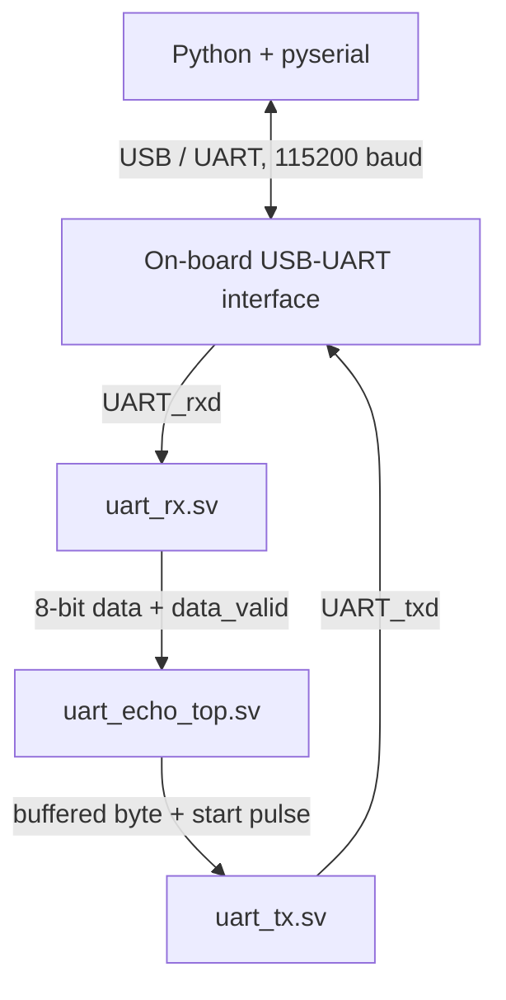

# UART Echo and Throughput Test — Boolean Board FPGA

A hardware UART communication project implemented on the **Real Digital Boolean Board** using a **Spartan-7 XC7S50 FPGA**. The FPGA receives bytes from a PC over the board's `PROG UART` USB connection and echoes the received data back to Python. The project also includes byte-for-byte stress testing with `pyserial`.

## Project status

- **UART echo:** Working.
- **Binary transfer validation:** Passed when data is sent in chunks and each chunk is checked before proceeding.
- **Best recorded result:** 32,768 bytes transferred and verified in 3.39 seconds using 512-byte chunks, approximately **9.43 KiB/s**.
- **Continuous unpaced transfer:** Not reliable yet. Larger continuous transfers produced missing and mismatched bytes, so the current design should be treated as a chunked-transfer demonstration rather than a fully flow-controlled streaming interface.

## Hardware and serial configuration

| Item | Configuration |
|---|---|
| FPGA board | Real Digital Boolean Board |
| FPGA | AMD/Xilinx Spartan-7 XC7S50 (`xc7s50csga324-1`) |
| FPGA clock | 100 MHz |
| UART baud rate | 115200 baud |
| Serial framing | 8 data bits, no parity, 1 stop bit (8-N-1) |
| Host interface | USB connector labeled `PROG UART` |
| PC software | Python 3 + `pyserial` |

The `PROG UART` connector provides the USB programming interface and UART/COM connection. Use a **data-capable** USB cable. The board must be powered on; for USB power, the board's J15 jumper should be set to `USB`.

## FPGA pin assignments

The following pin assignments are from the official [Boolean Board constraints file](https://www.realdigital.org/downloads/8d5c167add28c014173edcf51db78bb9.txt).

| Top-level signal | FPGA package pin | Purpose |
|---|---|---|
| `clk` | `F14` | 100 MHz board oscillator |
| `UART_rxd` | `V12` | Serial data from the PC to the FPGA |
| `UART_txd` | `U11` | Serial data from the FPGA to the PC |
| `btn[0]` | `J2` | Reset input used by this design |

> **Important:** Keep the port names in the XDC consistent with the top-level SystemVerilog module. If you already use the complete official constraints file, reuse its UART entries rather than adding duplicate pin constraints.

### Minimal XDC constraints

```tcl
# Boolean Board: 100 MHz oscillator
set_property -dict {PACKAGE_PIN F14 IOSTANDARD LVCMOS33} [get_ports {clk}]

# Reset button 0
set_property -dict {PACKAGE_PIN J2 IOSTANDARD LVCMOS33} [get_ports {btn[0]}]

# USB-UART interface
set_property -dict {PACKAGE_PIN V12 IOSTANDARD LVCMOS33} [get_ports {UART_rxd}]
set_property -dict {PACKAGE_PIN U11 IOSTANDARD LVCMOS33} [get_ports {UART_txd}]

# 100 MHz clock constraint
create_clock -add -name sys_clk_pin -period 10.000 \
    -waveform {0 5} [get_ports {clk}]

# Configuration voltage settings from the board constraints
set_property CFGBVS VCCO [current_design]
set_property CONFIG_VOLTAGE 3.3 [current_design]
```

## Design architecture



### RTL modules

- **`uart_rx.sv`** — Receives UART frames and reconstructs 8-bit data. The asynchronous RX pin passes through a two-flip-flop synchronizer (`rx_meta` and `rx_sync`). The receiver detects the start bit, validates it near the bit center, samples data LSB-first, and accepts a byte when the stop bit is high. `data_valid` pulses when a valid byte is available.
- **`uart_tx.sv`** — Transmits a byte using a start bit, eight data bits (least-significant bit first), and a stop bit. `start` is an internal FPGA control input; it is not sent by Python. `busy` indicates that the transmitter is active.
- **`uart_echo_top.sv`** — Connects the receiver and transmitter and buffers received bytes in a 16-entry FIFO before echoing them back. Button 0 is used as reset.

### UART timing

At 115200 baud, each bit lasts about 8.68 microseconds. With a 100 MHz FPGA clock:

$$
\text{clocks per bit} = \frac{100,000,000}{115,200} \approx 868
$$

For 8-N-1 framing, each payload byte consumes 10 serial bits (one start bit, eight data bits, and one stop bit). The ideal maximum payload throughput is therefore:

$$
\frac{115,200}{10 \times 1024} = 11.25\ 	ext{KiB/s}
$$

## Build and program with Vivado

1. Create a Vivado RTL project for the Boolean Board's `xc7s50csga324-1` FPGA.
2. Add `uart_rx.sv`, `uart_tx.sv`, and `uart_echo_top.sv` as design sources. Use SystemVerilog support for the `.sv` files.
3. Add the XDC constraints above, or use the relevant entries from the official Boolean Board constraints file.
4. Set `uart_echo_top` as the top module.
5. Run **Synthesis**, **Implementation**, and **Generate Bitstream**.
6. Open **Hardware Manager**, connect to the board, and program the generated bitstream.
7. Connect the PC to `PROG UART`, release reset, and identify the assigned COM port in Windows Device Manager under **Ports (COM & LPT)**.

Official references: [Boolean Board](https://www.realdigital.org/hardware/boolean), [Boolean Board setup and USB connections](https://www.realdigital.org/doc/02013cd17602c8af749f00561f88ae21), [official constraints file](https://www.realdigital.org/downloads/8d5c167add28c014173edcf51db78bb9.txt).

## Python setup

Install Python 3 if needed, then install `pyserial`:

```bash
python -m pip install pyserial
```

Close any other terminal or serial-monitor application that is using the same COM port before running the test.

## Chunked binary stress test

The stress test sends random binary data rather than only printable text. 
It transmits one chunk, reads the corresponding echo, compares the bytes, and then continues. This pacing avoids the failures seen in the initial unpaced continuous-stream test.


If Windows assigns a different COM port, update `PORT` before running the script.

## Test results recorded so far

| Test | Bytes sent | Bytes received | Elapsed time | Result |
|---|---:|---:|---:|---|
| Initial unpaced continuous test | 32,768 | 12,323 | 12.621 s | Fail; 20,445 bytes missing and 4,085 mismatches among compared positions |
| Concurrent Python reader, still unpaced | 32,768 | 32,726 | 10.532 s | Fail; 42 bytes missing and 23,580 positional mismatches |
| 8-byte chunk test | 32,768 | 32,768 | 65.89 s | Pass; 0.49 KiB/s |
| 512-byte chunk test | 32,768 | 32,768 | 3.39 s | Pass; 9.43 KiB/s |

The successful chunked test verifies byte-for-byte correctness for that transfer procedure. It does **not** prove that an indefinitely continuous stream is safe or that the receiver can never overflow.

## Known limitations and next improvements

- The current echo top uses a 16-byte FIFO and has no hardware flow control.
- Unpaced continuous transfer tests were unreliable; do not use the current design as a guaranteed lossless continuous-stream endpoint.
- Keep the baud rate at 115200 while debugging. Higher baud rates are not useful until correctness is established.
- Potential next improvements are flow control or a request/response protocol, better FIFO overflow reporting, a counter for received/dropped bytes, and simulation of back-to-back frames.

## Repository scope

This repository documents the UART communication work only: UART RX/TX RTL, the echo top, Boolean Board pin constraints, and PC-side serial tests. Machine-learning inference is outside this project's scope.
